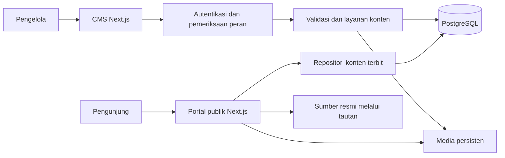
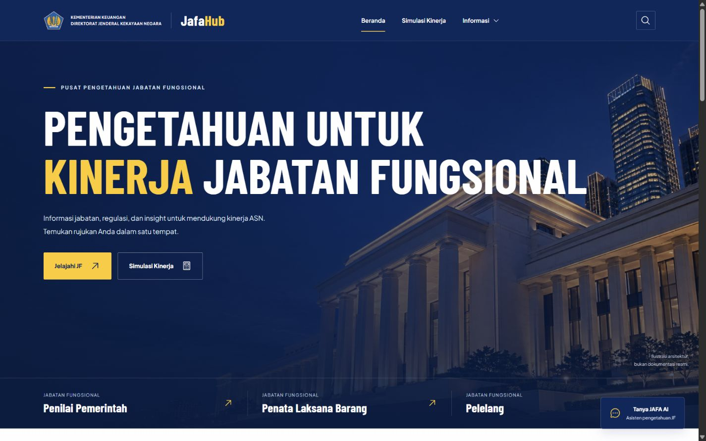
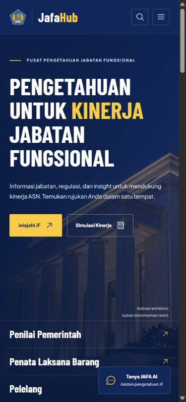
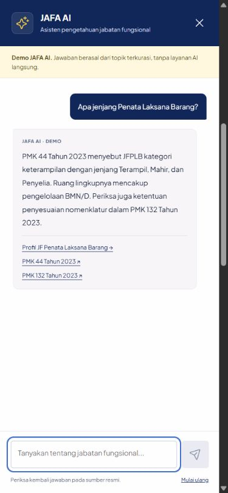
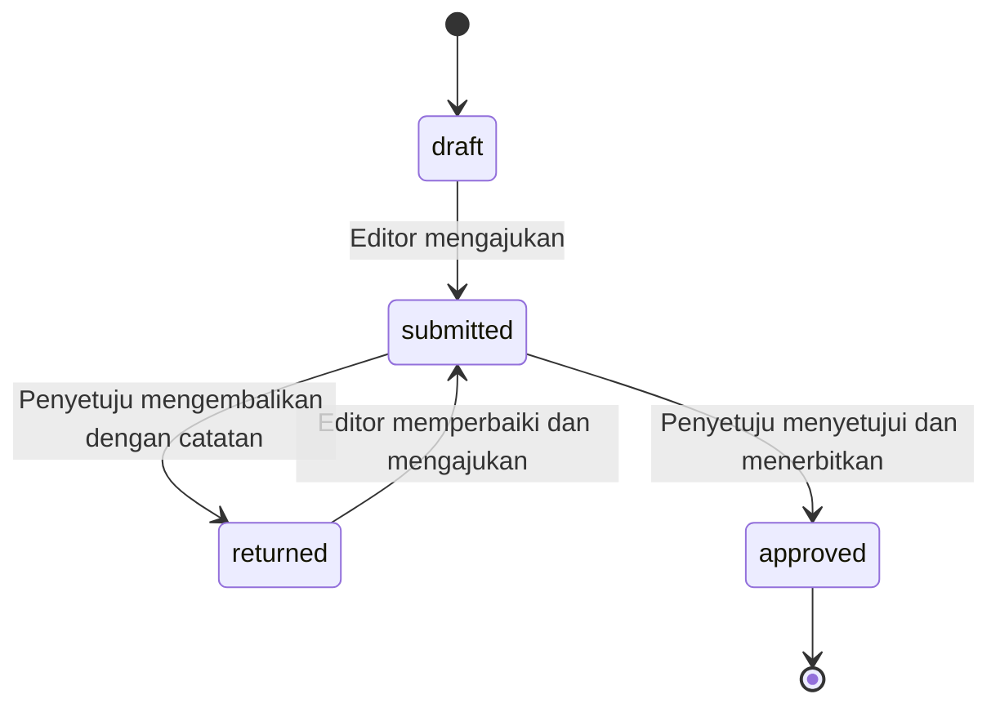

# Product Requirements Document — Jafa Hub

| Identitas | Keterangan |
| --- | --- |
| Produk | Jafa Hub — Portal Pengetahuan Jabatan Fungsional DJKN |
| Versi dokumen | 1.0 |
| Tanggal penyusunan | 22 Oktober 2026 |
| Status | Draf kebutuhan untuk tinjauan produk, substansi, dan teknis; bukan bukti aplikasi produksi telah selesai |
| Pemilik substansi | Subdirektorat Pengelolaan Jabatan Fungsional, Direktorat Transformasi dan Sistem Informasi, DJKN |
| Pembaca utama | Tim developer dan AI agent pelaksana |
| Bahasa dan zona waktu | Bahasa Indonesia; tampilan waktu Asia/Jakarta, penyimpanan timestamp UTC |
| Dasar keputusan | Pemeriksaan bahan lokal dan jawaban pengguna pada sesi perencanaan |

## Daftar isi

1. [Ringkasan produk](#1-ringkasan-produk)
2. [Bahan sumber dan kondisi awal](#2-bahan-sumber-dan-kondisi-awal)
3. [Tujuan website dan ukuran keberhasilan](#3-tujuan-website-dan-ukuran-keberhasilan)
4. [Target pengguna dan tanggung jawab](#4-target-pengguna-dan-tanggung-jawab)
5. [Cakupan dan prioritas rilis](#5-cakupan-dan-prioritas-rilis)
6. [Platform, framework, dan arsitektur](#6-platform-framework-dan-arsitektur)
7. [Identitas visual dan referensi desain](#7-identitas-visual-dan-referensi-desain)
8. [Sitemap dan navigasi](#8-sitemap-dan-navigasi)
9. [Struktur dan isi halaman](#9-struktur-dan-isi-halaman)
10. [Kebutuhan fungsional dan kriteria penerimaan](#10-kebutuhan-fungsional-dan-kriteria-penerimaan)
11. [CMS, peran, dan persetujuan](#11-cms-peran-dan-persetujuan)
12. [Aturan simulator Angka Kredit](#12-aturan-simulator-angka-kredit)
13. [Model data dan integritas](#13-model-data-dan-integritas)
14. [Antarmuka dan alur data](#14-antarmuka-dan-alur-data)
15. [Kebutuhan nonfungsional](#15-kebutuhan-nonfungsional)
16. [Migrasi, pengujian, dan penerimaan](#16-migrasi-pengujian-dan-penerimaan)
17. [Tahapan implementasi dan peluncuran](#17-tahapan-implementasi-dan-peluncuran)
18. [Asumsi, keputusan terbuka, dan risiko](#18-asumsi-keputusan-terbuka-dan-risiko)
19. [Referensi dan glosarium](#19-referensi-dan-glosarium)

## 1. Ringkasan produk

Jafa Hub adalah website publik yang memusatkan pengetahuan jabatan fungsional dalam lingkup pembinaan DJKN. Pengguna dapat mengenali tugas dan kompetensi jabatan, membaca artikel, menelusuri sumber regulasi, mencari jawaban terkurasi, serta mempelajari konversi predikat kinerja menjadi Angka Kredit melalui simulator.

Produk dikembangkan dari prototipe statis yang sudah tersedia menjadi aplikasi Next.js dengan database PostgreSQL dan CMS. Pengunjung tidak perlu membuat akun. Pengelola masuk melalui area admin dengan pemisahan peran editor, penyetuju, dan admin akun.

Tiga pintu masuk materi awal mengikuti prototipe: **JF Penilai Pemerintah, JF Penata Laksana Barang, dan JF Pelelang**. Penggunaan istilah tersebut memudahkan penelusuran bahan awal; penamaan resmi, catatan transisi, dan cakupan jabatan harus ditinjau unit pemilik substansi sebelum peluncuran. Website bukan sistem penetapan PAK atau keputusan kepegawaian.

Rilis pertama mengutamakan portal dan pengelolaan konten yang dapat dioperasikan. Asisten tetap berbasis FAQ terkurasi dan dilabeli dengan jelas. AI berbasis dokumen direncanakan sesudah alur konten dan tata kelola sumber berjalan.

## 2. Bahan sumber dan kondisi awal

### 2.1 Sumber lokal

Direktori bahan pengguna: `C:\Users\ASUS\Documents\Magang DJKN`, diakses pada sesi ini melalui `/mnt/c/Users/ASUS/Documents/Magang DJKN`.

| Bahan | Kegunaan dalam PRD | Batas penggunaan |
| --- | --- | --- |
| `knowledge/Paparan DirTSI_JF1_JF3_PemprovBanten_0208.pptx` — 18 slide | Konteks transformasi JF, pembinaan, dan relevansi pengelolaan aset | Paparan bertanggal 2 Agustus 2024; angka sebaran dan kondisi saat itu merupakan data historis |
| `knowledge/Paparan Kasubdit_JF1_JF3_PemprovBanten_0208.pptx` — 31 slide | Materi pelaksanaan tugas, pengukuran kinerja, dan kompetensi | Teks diekstrak dari slide; isi yang tertanam dalam gambar tidak seluruhnya diverifikasi |
| `jafa-hub/CONTEXT.md`, `README.md`, `SOURCES.md`, `VERIFICATION.md` | Tujuan awal, fitur, sumber, identitas visual, dan catatan pengujian sebelumnya | Pernyataan historis dicocokkan dengan berkas aktual; bukan instruksi untuk menambah pekerjaan di luar PRD |
| `jafa-hub/dist/` dan `jafa-hub/tests/` | Perilaku prototipe dan skenario regresi simulator serta konten | Tidak dianggap sebagai implementasi backend atau CMS |
| `assets/` dan aset prototipe | Logo, font, ilustrasi, ikon, dan lisensi | Proporsi logo dipertahankan; ilustrasi konseptual tidak diklaim sebagai dokumentasi resmi |
| Tangkapan layar arsip pembangunan | Referensi visual desktop, mobile, dan panel asisten | Disertakan pada bagian 7 sebagai rekaman prototipe, bukan desain CMS produksi |

Paparan digunakan untuk merumuskan masalah dan materi awal. Data biografi narasumber serta salinan presentasi asli tidak otomatis menjadi konten publik.

### 2.2 Kondisi yang tersedia

- Prototipe menggunakan HTML, CSS, dan JavaScript modular tanpa framework atau dependency aplikasi; navigasinya berbasis hash.
- Tersedia beranda, tiga profil JF, daftar/detail artikel, pustaka regulasi dalam dialog, pencarian, simulator, serta chatbot demo berbasis pencocokan topik.
- Data awal terdiri dari tiga profil JF, empat artikel, enam rujukan regulasi, FAQ profil, dan tujuh topik asisten. Data harus diperiksa kembali pada migrasi jika sumber berubah.
- Riwayat asisten hanya berada dalam memori tab. Tidak tersedia akun, database, CMS, backend produksi, atau integrasi model AI.
- Dokumentasi mencatat sembilan tes prototipe pernah lulus. Hasil tersebut bukan pengujian sistem produksi yang dirancang dalam PRD ini.
- Tanggal tinjauan konten dalam prototipe adalah 21 Oktober 2026. Tanggal penyusunan PRD tidak boleh otomatis mengganti tanggal tinjauan substansi.

## 3. Tujuan website dan ukuran keberhasilan

### 3.1 Masalah yang ditangani

Informasi pembinaan tersebar dalam paparan, peraturan, dan publikasi. Pengguna membutuhkan titik masuk berdasarkan jabatan serta jalur yang jelas dari ringkasan ke sumber resmi. Prototipe membantu eksplorasi tampilan, tetapi perubahan konten masih memerlukan penyuntingan kode dan belum memiliki proses persetujuan.

### 3.2 Tujuan produk

| ID | Tujuan | Hasil yang diharapkan |
| --- | --- | --- |
| G-01 | Memusatkan pengetahuan JF | Pengguna menemukan profil, kompetensi, artikel, FAQ, dan rujukan pada satu portal |
| G-02 | Memudahkan pembelajaran konversi Angka Kredit | Pengguna memperoleh hasil simulasi beserta input, rumus, dan sumbernya |
| G-03 | Memberi kendali konten kepada unit pengelola | Perubahan konten rutin dilakukan melalui CMS tanpa menyunting kode |
| G-04 | Menjaga akuntabilitas publikasi | Konten publik berasal dari revisi yang disetujui, dengan sumber dan tanggal tinjauan |
| G-05 | Menyediakan akses lintas perangkat | Alur inti dapat digunakan melalui ponsel, tablet, desktop, dan keyboard |

### 3.3 Pengukuran keberhasilan

Target berikut merupakan **kriteria usulan penerimaan produk**, bukan hasil pengukuran saat ini atau janji trafik.

| Ukuran | Target awal | Cara pengukuran |
| --- | --- | --- |
| Menemukan rujukan | Sedikitnya 80% peserta UAT menemukan rujukan yang diminta dalam 2 menit tanpa arahan | Minimal 5 peserta mewakili ASN/pengelola kepegawaian; catat tugas, waktu, dan hasil |
| Menyelesaikan simulasi | Sedikitnya 80% peserta menyelesaikan satu simulasi valid tanpa bantuan | UAT dengan skenario tertulis dan hasil acuan |
| Pengelolaan konten | Editor dan penyetuju menyelesaikan satu siklus revisi sampai terbit tanpa mengubah kode | UAT bersama calon petugas masing-masing peran |
| Kelengkapan materi | 100% profil, artikel, regulasi, dan FAQ yang diterbitkan memiliki sumber serta tanggal tinjauan | Pemeriksaan otomatis sebelum pengajuan dan audit konten awal |
| Perlindungan konten | Tidak ada draf/revisi belum disetujui yang terbaca melalui antarmuka publik | Tes integrasi dan E2E akses publik |
| Ketepatan simulator | Seluruh skenario acuan dan validasi pada bagian 12 lulus | Pengujian otomatis deterministik |

Ukur penerimaan melalui pengujian dan catatan operasional. Analitik pihak ketiga dan pelacakan perilaku pengunjung tidak masuk rilis pertama; kebutuhan tersebut memerlukan keputusan privasi terpisah.

## 4. Target pengguna dan tanggung jawab

| Kelompok | Kebutuhan | Contoh aktivitas |
| --- | --- | --- |
| ASN pemangku JF | Materi relevan dengan jabatan, kompetensi, dan kinerja | Membuka profil JF lalu mencoba simulator |
| ASN yang mempertimbangkan jalur JF | Gambaran tugas, jenjang, dan rujukan pengembangan | Membandingkan pengantar tiga JF dan membaca FAQ |
| Pengelola kepegawaian K/L dan Pemda | Rujukan pembinaan yang dapat ditelusuri | Mencari peraturan berdasarkan nomor dan membuka sumber resmi |
| Masyarakat umum | Informasi publik tentang JF dan pengelola portal | Membaca artikel serta halaman Tentang |
| Editor | Penyusunan dan pemutakhiran konten | Menyunting draf, menambah sumber, lalu mengajukan pemeriksaan |
| Penyetuju | Pemeriksaan substansi sebelum publikasi | Membandingkan revisi dengan versi publik, mengembalikan atau menerbitkan |
| Admin | Pengelolaan akses operasional | Membuat/menonaktifkan akun dan menetapkan peran |

Pemilik substansi menetapkan petugas editor dan penyetuju, memeriksa ketepatan nomenklatur serta aturan, dan menyetujui materi awal. Penanggung jawab teknis mengelola aplikasi, pencadangan, keamanan, dan pemulihan; nama petugas teknis ditetapkan sebelum peluncuran.

## 5. Cakupan dan prioritas rilis

**P0** wajib sebelum peluncuran. **P1** penyempurnaan setelah P0 stabil dan bukan syarat rilis awal. **P2** fase lanjutan yang memerlukan perencanaan tersendiri.

| Prioritas | Kemampuan |
| --- | --- |
| P0 | Portal publik, profil tiga JF, artikel, regulasi bertautan resmi, FAQ, pencarian, simulator konversi dasar |
| P0 | Tentang, Kontak resmi tanpa formulir, Privasi, navigasi mobile, halaman kosong/gagal/404 |
| P0 | CMS, autentikasi pengelola, peran terpisah, revisi konten, persetujuan, penarikan, serta jejak tindakan |
| P0 | Pengelolaan gambar artikel dan profil beserta teks alternatif dan atribusi |
| P0 | Asisten FAQ terkurasi yang mengambil jawaban terbit dari CMS |
| P0 | Migrasi awal, pengujian, tinjauan substansi, backup, dan panduan operasional |
| P1 | Penyempurnaan pengalaman berdasarkan temuan UAT dan penggunaan nyata |
| P2 | AI berbasis dokumen dengan jawaban bersumber dan evaluasi kualitas |

Pembaruan arah 11 November 2026: pengguna menyetujui perencanaan RAG paralel dengan C2 dan aktivasi beta setelah evaluasi. Sumbernya PDF resmi undang-undang/peraturan JF yang akan disediakan pengguna; model menggunakan API hosted dengan anggaran murah, bukan deployment model lokal. Rincian dan keputusan terbuka di [PRD tambahan RAG](docs/PRD-RAG-Jafa-Hub.md). Ini tidak otomatis menjadikan RAG syarat P0 atau mengizinkan unduhan publik PDF; asisten FAQ yang sudah ada tetap berlaku sampai fitur generatif benar-benar diimplementasikan.

Di luar rilis pertama: akun ASN/publik, riwayat simulasi di server, SSO instansi, komentar, newsletter, formulir kontak, pengunggahan PPT/PDF untuk unduhan publik, pengajuan PAK, simulasi kenaikan pangkat, perubahan rumus dari CMS, integrasi sistem kepegawaian, aplikasi mobile native, serta penerbitan otomatis dari sumber eksternal.

## 6. Platform, framework, dan arsitektur

### 6.1 Keputusan teknologi

| Lapisan | Pilihan | Alasan dan batas |
| --- | --- | --- |
| Platform | Website responsif, satu bahasa Indonesia | Tidak memerlukan pemasangan aplikasi |
| Aplikasi | Next.js App Router dengan React dan TypeScript | Portal dan CMS berada dalam satu aplikasi; gunakan halaman server untuk pembacaan dan komponen klien untuk interaksi |
| Backend | Server Actions Next.js untuk mutasi CMS; Route Handlers untuk autentikasi, media, dan layanan publik yang diperlukan | Tidak membuat backend layanan terpisah atau API eksternal umum |
| Database | PostgreSQL | Menyimpan akun, revisi, publikasi, relasi, dan audit |
| Akses data | Prisma ORM dan migrasi database | Transaksi digunakan untuk keputusan publikasi yang mengubah beberapa entitas |
| Autentikasi | Better Auth, akun email/password dengan sesi database | Registrasi publik dimatikan pada server; gunakan integrasi Next.js resmi |
| Styling | CSS Modules dan token CSS bersama | Gunakan ulang identitas prototipe tanpa menambah framework CSS untuk kebutuhan sederhana |
| Pencarian | PostgreSQL pada proyeksi konten terbit | Pencocokan teks awal memakai kueri berparameter; tidak memerlukan layanan pencarian eksternal |
| Media | Direktori unggahan pada volume persisten di luar artefak build | Metadata dalam PostgreSQL; akses privat untuk gambar draf dan akses publik hanya jika dipakai revisi terbit |
| Pengujian | Unit untuk domain; integrasi dengan PostgreSQL uji; Playwright untuk alur browser | Pengujian menargetkan risiko perhitungan, publikasi, akses, dan alur inti |

Prisma dan Better Auth adalah default teknis pelaksanaan, bukan komponen yang telah terpasang pada prototipe. Versi Next.js, runtime Node.js yang didukung, PostgreSQL, dan library dikunci pada awal implementasi setelah kompatibilitas diperiksa; jangan menggunakan versi prarilis. Dasar pilihan: [Next.js App Router](https://nextjs.org/docs/app), [Better Auth untuk Next.js](https://better-auth.com/docs/integrations/next), dan [transaksi Prisma](https://www.prisma.io/docs/orm/fundamentals/transactions).

### 6.2 Alur arsitektur



Konten publik diambil di server melalui repositori yang hanya mengembalikan revisi terbit. Halaman admin, sesi, dan pratinjau tidak menggunakan cache publik. Rilis awal tidak memerlukan cache lintas permintaan untuk data konten sehingga penerbitan dan penarikan terlihat pada pemuatan berikutnya. Optimasi cache ditambahkan hanya jika pengukuran membutuhkan dan harus mempertahankan uji penarikan konten.

Simulator menjalankan fungsi murni di browser dan tidak mengirim input ke server. Tidak ada ketergantungan layanan AI, SMTP, analitik, atau cloud tertentu pada rilis awal.

### 6.3 Lingkungan operasional

Sediakan lingkungan lokal, staging, dan produksi dengan database serta rahasia terpisah. Staging memakai data uji tanpa salinan informasi pribadi produksi dan dibatasi aksesnya. Runtime produksi memerlukan Node.js yang didukung, koneksi PostgreSQL, volume media persisten, HTTPS, dan penjadwal backup. Jika dikelola sendiri, pasang reverse proxy di depan aplikasi sebagaimana [panduan self-hosting Next.js](https://nextjs.org/docs/app/guides/self-hosting).

Hosting dan domain ditentukan instansi sebelum peluncuran. Hosting statis saja tidak memenuhi kebutuhan CMS dan database. Default penempatan adalah satu instance aplikasi dengan volume persisten; jika penyedia hanya menawarkan filesystem sementara, keputusan penyimpanan objek harus diselesaikan sebelum deployment, bukan menyimpan unggahan pada disk sementara.

## 7. Identitas visual dan referensi desain

### 7.1 Arah desain

Karakter website: institusional, tegas, mudah dipindai, dan berorientasi pada pengetahuan. Pertahankan identitas Jafa Hub serta pengelompokan materi prototipe; tata letak disesuaikan untuk konten produksi, keterbacaan, dan aksesibilitas.

Hero menggunakan navy, foto arsitektur/aset sebagai ilustrasi, judul singkat, dan dua tindakan: **Jelajahi JF** serta **Simulasi Angka Kredit**. Bagian artikel dan regulasi menggunakan latar terang. CMS menggunakan tabel dan formulir yang jelas, tanpa hero dekoratif.

### 7.2 Skema warna

| Token | Warna | Penerapan |
| --- | --- | --- |
| `--navy` | `#02275D` | Header, identitas utama, tombol sekunder, teks di atas kuning |
| `--deep` | `#031B3B` | Dasar hero dan lapisan gelap |
| `--yellow` | `#FFCB05` | Aksen judul, tindakan utama, penanda navigasi |
| `--green` | `#098D44` | Status berhasil dan aksen pendukung dengan pasangan kontras teruji |
| `--paper` | `#FFFFFF` | Latar utama |
| `--soft` | `#F3F6F9` | Latar bagian dan panel pendukung |
| `--ink` | `#12243D` | Teks utama |
| `--muted` | `#56677B` | Teks pendukung |
| `--line` | `#DCE3EC` | Pemisah dan batas dekoratif; bukan satu-satunya penanda kontrol |
| Status gagal | Merah dengan kontras teruji saat implementasi | Pesan kesalahan selalu disertai teks, bukan hanya warna |

Kuning dipasangkan dengan teks navy; hindari teks kuning di atas putih. Warna institusi tidak membebaskan pemeriksaan kontras. Kontrol, fokus, dan status memiliki indikator yang tetap dipahami tanpa membedakan warna.

### 7.3 Tipografi, aset, dan komponen

- Judul memakai **Barlow Condensed**, isi dan formulir memakai **Plus Jakarta Sans**, dimuat lokal bersama lisensinya. Isi utama minimal 16 px dengan tinggi baris sekitar 1,6–1,75.
- Logo Kemenkeu/DJKN menggunakan aset asli, proporsi tetap, tidak diregangkan atau digambar ulang. Penggunaan pada situs produksi dikonfirmasi instansi sebelum publikasi.
- Ikon mengikuti Phosphor yang sudah digunakan prototipe; lisensi disertakan. Ikon tindakan tanpa teks harus memiliki nama aksesibel.
- Gunakan kontainer konten maksimal sekitar 1.248 px; jarak sisi 20 px pada ponsel dan bertambah pada layar besar. Tata letak satu kolom pada ponsel, dua atau tiga kolom bila ruang cukup.
- Tombol dan input memakai radius dasar 2 px; panel asisten desktop dapat memakai 12 px sesuai prototipe. Target sentuh disarankan minimal 44 × 44 px.
- Artikel menggunakan lebar baca sekitar 65–75 karakter per baris. Semua gambar memiliki dimensi/aspect ratio agar tata letak tidak bergeser.
- Animasi singkat untuk transisi antarmuka, menghormati `prefers-reduced-motion`; tanpa video otomatis atau efek scroll yang menghalangi pembacaan.
- Ilustrasi generatif diberi keterangan konseptual. Foto resmi baru memerlukan asal dan hak penggunaan yang jelas.

### 7.4 Referensi desain dan tangkapan layar

| Referensi | Kedudukan | Unsur yang diterapkan |
| --- | --- | --- |
| Prototipe lokal Jafa Hub | Acuan utama identitas visual | Navy/kuning, tipografi, hero, akses tiga JF, pengelompokan artikel dan regulasi |
| [U.S. Air Force](https://www.airforce.com/) | Inspirasi historis yang tercatat pada dokumentasi proyek | Komposisi hero lebar, judul dominan, dan hierarki tindakan; tidak menyalin konten, aset, atau struktur rekrutmen |
| Tampilan CMS | Rancangan baru berdasarkan tugas pengelola | Sidebar, tabel konten, label status, pratinjau, dan panel keputusan |

Halaman Air Force dibuka untuk memeriksa sumber pada 22 Oktober 2026. Tidak ada tangkapan layar situs tersebut yang disertakan; unsur visual historis di atas berasal dari dokumentasi proyek. Rekaman prototipe berikut ditemukan dalam arsip pembangunan sebelumnya, diperiksa secara visual, dan disalin sebagai lampiran PRD. Rekaman ini bukan hasil pengujian baru atau mockup sistem produksi.

**Referensi desktop — beranda prototipe**



**Referensi mobile — beranda prototipe**



**Referensi mobile — asisten demo**



Pada rilis produksi pertama, label panel menjadi **Asisten FAQ Jafa Hub** dengan keterangan **Jawaban terkurasi, bukan AI generatif**. Nama JAFA AI tetap digunakan untuk rencana fase AI berbasis dokumen.

## 8. Sitemap dan navigasi

### 8.1 Sitemap publik

```text
Jafa Hub
├── Beranda /
├── Tentang Jafa Hub /tentang
├── Informasi JF /informasi
│   ├── Penilai Pemerintah /informasi/penilai-pemerintah
│   ├── Penata Laksana Barang /informasi/penata-laksana-barang
│   └── Pelelang /informasi/pelelang
├── Wawasan & Kabar /insight
│   └── Detail artikel /insight/[slug]
├── Pustaka Regulasi /regulasi
├── FAQ /faq
├── Simulasi Angka Kredit /simulasi
├── Pencarian /pencarian?q=...
├── Kontak /kontak
├── Privasi /privasi
└── Halaman 404 dan penanganan gagal memuat
```

Asisten FAQ adalah panel global di seluruh halaman publik, bukan halaman terpisah. Regulasi membuka sumber resmi; tidak ada penyimpanan dokumen regulasi atau halaman detail regulasi tersendiri pada rilis awal.

### 8.2 Sitemap pengelola

```text
CMS
├── Login /admin/login
├── Penggantian sandi awal /admin/ganti-sandi
├── Dashboard /admin
├── Profil JF /admin/profil-jf
├── Artikel /admin/artikel
├── Regulasi /admin/regulasi
├── FAQ /admin/faq
├── Halaman Pendukung /admin/halaman
├── Persetujuan /admin/persetujuan
├── Pengguna /admin/pengguna
└── Aktivitas /admin/aktivitas
```

Modul konten menyediakan daftar dan halaman `/{id}` untuk menyunting/pratinjau; artikel, regulasi, dan FAQ juga memiliki `/baru`. Profil tiga JF serta halaman Tentang, Kontak, Privasi merupakan rekaman tetap sehingga tidak dibuat atau dihapus bebas. Pemilihan gambar berada di formulir, tanpa modul galeri publik terpisah. Editor dan penyetuju dapat meninjau revisi yang diizinkan melalui halaman detail CMS.

### 8.3 Navigasi dan URL

- Header: logo menuju Beranda; menu **Beranda, Informasi JF, Wawasan & Kabar, Regulasi, Simulasi**; tombol pencarian dan asisten FAQ. Pembuka FAQ mengikuti aliran tata letak header agar tidak menutupi konten saat membaca atau memindahkan fokus.
- Dropdown Informasi JF menyediakan pengantar dan tiga profil. Pada mobile gunakan menu yang dapat dioperasikan dengan sentuhan dan keyboard.
- Footer: Tentang, FAQ, Kontak, Privasi, tautan resmi DJKN, identitas unit pengelola, dan keterangan batas simulator.
- Halaman detail menyediakan breadcrumb. Halaman aktif ditandai secara visual serta aksesibel.
- Login CMS tidak menjadi tindakan utama pengunjung; URL akses diberikan kepada petugas.
- Slug profil dan halaman pendukung tetap. Slug artikel boleh disunting sebelum terbit pertama, lalu dikunci untuk menjaga tautan. Slug unik dan tidak boleh digunakan ulang setelah penarikan.
- URL produksi menggunakan path normal. Navigasi hash lama yang dikenali diarahkan di browser ke padanan path, termasuk daftar/detail artikel. Hash tak dikenal tidak boleh membuat redirect ke domain luar.

## 9. Struktur dan isi halaman

| Halaman | Susunan isi minimum | Keadaan khusus |
| --- | --- | --- |
| Beranda | Hero, dua CTA, tiga pintu masuk JF, pengantar peran, artikel terbaru, regulasi pilihan, pengantar simulator | Bagian tanpa konten menampilkan pesan atau disembunyikan dengan rapi; tanpa angka/statistik rekaan |
| Tentang | Tujuan, sasaran, manfaat, unit pengelola, tata kelola sumber, batas layanan | Tidak menyatakan telah menjadi layanan resmi produksi sebelum persetujuan instansi |
| Informasi JF | Pengantar dan tiga kartu profil | Nama dan catatan nomenklatur memakai materi yang disetujui |
| Detail JF | Breadcrumb, nama, pengantar, definisi, kategori/jenjang, tugas, kompetensi, catatan nomenklatur, regulasi, artikel terkait, FAQ, tanggal tinjauan | Materi lama diberi konteks; tidak menyamakan semua pilihan simulator dengan jabatan yang otomatis tersedia di instansi |
| Daftar artikel | Judul, filter bidang JF/jenis artikel, daftar, tanggal, paginasi | Filter kosong menyediakan reset; 12 artikel per halaman |
| Detail artikel | Judul, jenis, tanggal publikasi/tinjauan, ringkasan, gambar dan atribusi, isi, sumber, artikel terkait | Draf dan konten ditarik memberikan 404 pada URL publik |
| Regulasi | Pencarian, filter bidang JF, nomor, judul, penerbit, ringkasan, tanggal tinjauan, tautan resmi, catatan status | Status belum diverifikasi tidak boleh disajikan sebagai aturan yang dipastikan masih berlaku |
| FAQ | Filter topik/JF, daftar pertanyaan dan jawaban, tautan sumber | Jawaban disajikan dari versi terbit yang sama dengan asisten |
| Simulator | Pengantar, batas penggunaan, kategori, jenjang, predikat, periode, tombol hitung/reset, hasil beserta substitusi dan rujukan | Validasi di dekat input; hasil lama dihapus saat input berubah |
| Pencarian | Input, kueri aktif, filter jenis, jumlah hasil, ringkasan dan tautan, paginasi | Kueri kosong meminta input; tidak ditemukan memberi saran; 10 hasil per halaman |
| Kontak | Nama unit, tujuan menghubungi, kanal resmi terverifikasi, jam layanan jika tersedia | Tanpa formulir; nomor, email, alamat, atau jam layanan tidak diisi dengan data perkiraan |
| Privasi | Jenis data yang benar-benar diolah, tujuan, sesi admin, log, retensi, kanal penanggung jawab | Disesuaikan dengan hosting aktual sebelum terbit; tidak menjanjikan tanpa log jika infrastruktur mencatat log |
| Dashboard CMS | Jumlah konten berdasarkan status, antrean sesuai peran, aktivitas terbaru yang diizinkan | Tanpa grafik trafik pengunjung yang belum diukur |
| Daftar CMS | Pencarian, filter status/JF, judul, penyunting, waktu perubahan, status kerja dan publikasi | 20 baris per halaman; tindakan mengikuti peran |
| Formulir CMS | Kolom isi, sumber, tanggal tinjauan, relasi JF, gambar/alt jika digunakan, simpan, pratinjau, ajukan | Perubahan belum disimpan ditandai; gagal simpan mempertahankan input di halaman |
| Persetujuan | Antrean, pratinjau revisi, pembanding versi publik, keputusan dan catatan | Tidak mengubah isi selama revisi menunggu keputusan |
| Pengguna | Daftar akun, peran, status aktif, pembuatan, penggantian peran, reset sandi | Tidak boleh menonaktifkan atau menurunkan peran admin aktif terakhir |
| Aktivitas | Pelaku, jenis tindakan, objek, waktu, catatan keputusan | Data audit tidak dapat disunting melalui CMS |

Hero dan label navigasi dikelola sebagai bagian aplikasi, bukan page builder. Editor hanya mengubah jenis konten dan halaman pendukung yang disebutkan di PRD.

## 10. Kebutuhan fungsional dan kriteria penerimaan

Seluruh kebutuhan pada tabel ini berprioritas P0.

| ID | Kebutuhan | Kriteria penerimaan |
| --- | --- | --- |
| FR-01 | Navigasi publik | Semua rute pada sitemap dapat dibuka langsung, dimuat ulang, dan dinavigasi pada desktop/mobile; link aktif dan breadcrumb sesuai |
| FR-02 | Profil JF | Ketiga profil menampilkan revisi terbit beserta tugas, kompetensi, sumber, dan tanggal tinjauan; perubahan draf tidak terlihat publik |
| FR-03 | Artikel | Filter dan paginasi berfungsi; detail memakai slug unik; daftar hanya berisi artikel terbit; sumber eksternal dikenali |
| FR-04 | Pustaka regulasi | Pengguna menemukan nomor/judul dan memfilter JF; tautan HTTPS menuju sumber resmi yang ditinjau pengelola; tidak ada unggahan PDF/PPT publik |
| FR-05 | FAQ | FAQ terbit dapat difilter dan dibuka dengan keyboard; sumber dan tautan terkait tersedia |
| FR-06 | Pencarian | Menemukan profil, artikel, regulasi, dan FAQ terbit tanpa membedakan kapital; draf tidak muncul; kueri kosong/hasil nihil memiliki pesan jelas |
| FR-07 | Simulator | Hasil dan validasi memenuhi bagian 12; perubahan input menghapus hasil lama; hasil tidak disimpan atau dipakai menetapkan keputusan karier |
| FR-08 | Asisten terkurasi | Saran topik dan pencarian FAQ memberi jawaban persis dari versi terbit, beserta rujukan; pertanyaan tidak cocok mendapat fallback tanpa jawaban rekaan |
| FR-09 | Halaman pendukung | Tentang menyebut unit dan tujuan; Kontak memakai kanal yang diverifikasi; Privasi sesuai data aktual; seluruhnya melalui persetujuan |
| FR-10 | Login pengelola | Kredensial valid membuka area sesuai peran; kredensial salah memberi pesan umum; registrasi publik ditolak oleh server |
| FR-11 | Pengelolaan akun | Admin dapat membuat, mereset, mengubah peran, dan menonaktifkan akun; sesi dicabut saat reset, perubahan peran, atau penonaktifan |
| FR-12 | Penyuntingan konten | Editor dapat membuat/mengubah draf sesuai jenis; validasi sumber dan kolom wajib berlaku saat pengajuan, bukan hanya di browser |
| FR-13 | Persetujuan | Penyetuju dapat mengembalikan dengan catatan atau menerbitkan revisi yang diajukan; editor/admin tidak dapat melompati proses lewat request langsung |
| FR-14 | Revisi dan pratinjau | Pratinjau membutuhkan sesi/peran; revisi yang menunggu keputusan tidak dapat diedit; revisi basi ditolak tanpa menimpa data baru |
| FR-15 | Penarikan konten | Penyetuju dapat menarik dengan alasan; setelah sukses, konten hilang dari seluruh tampilan publik, pencarian, FAQ/asisten, sitemap, dan media yang tidak lagi dirujuk publik |
| FR-16 | Jejak tindakan | Pembuatan, pengajuan, keputusan, penarikan, dan perubahan akun tercatat; kegagalan menyimpan audit membatalkan mutasi terkait |
| FR-17 | Gambar | Hanya format dan ukuran yang diizinkan; berkas draf tidak bisa diambil tanpa izin, bahkan jika ID diketahui; gambar terbit memiliki alt/atribusi sesuai penggunaannya |
| FR-18 | Keadaan antarmuka | Memuat, kosong, gagal, akses ditolak, sesi habis, dan konflik memiliki pesan serta tindakan pemulihan tanpa membocorkan detail internal |

### 10.1 Perilaku pencarian

Normalisasi kueri dengan memangkas spasi, merapikan spasi berulang, menyamakan kapital, serta mempertahankan angka nomor peraturan. Panjang maksimum 200 karakter. Semua kata kueri harus ditemukan pada gabungan judul, ringkasan, isi teks, atau kata kunci publik. Urutan mengutamakan kecocokan judul, lalu tanggal publikasi terbaru dan ID sebagai pemecah seri. Gunakan kueri database berparameter.

Data pencarian merupakan proyeksi versi terbit, diperbarui dalam transaksi penerbitan/penarikan. Tidak mengindeks sumber draf, informasi akun, atau catatan pemeriksaan. Tidak ada toleransi salah ketik atau pencarian semantik pada rilis pertama.

### 10.2 Perilaku asisten FAQ

Saat panel dibuka, tampilkan topik terkurasi. Jika pengguna mengetik, gunakan pencarian FAQ terbit: tampilkan jawaban saat hanya satu cocok; jika beberapa cocok, tampilkan pilihan pertanyaan; jika tidak ada, arahkan ke halaman FAQ, pencarian, atau kanal kontak. Jangan membentuk jawaban baru dari penggalan beberapa FAQ.

Jawaban menggunakan ID FAQ dan revisi terbit. Riwayat hanya di memori tab, bertahan saat panel ditutup, dapat direset, dan hilang ketika halaman dimuat ulang. Pertanyaan tidak disimpan ke database atau log aplikasi. Request pencocokan memakai POST agar teks pertanyaan tidak menjadi bagian URL. API tetap memerlukan pembatasan laju dan panjang input. Panel tidak menutupi tombol penting pada ponsel.

## 11. CMS, peran, dan persetujuan

### 11.1 Matriks hak akses

Satu akun pengelola memiliki satu peran. Pembatasan editor per bidang JF tidak diperlukan pada rilis awal; editor dapat mengelola seluruh bidang. Peran diperiksa di server pada setiap tindakan.

| Tindakan | Publik | Editor | Penyetuju | Admin |
| --- | --- | --- | --- | --- |
| Membaca konten terbit dan simulator | Ya | Ya | Ya | Ya |
| Melihat daftar/pratinjau konten kerja | Tidak | Ya | Ya | Tidak |
| Membuat/menyunting draf dan mengajukan | Tidak | Ya | Tidak | Tidak |
| Mengembalikan, menerbitkan, menarik | Tidak | Tidak | Ya | Tidak |
| Membuat/menonaktifkan akun dan menetapkan peran | Tidak | Tidak | Tidak | Ya |
| Melihat aktivitas konten | Tidak | Pada objek yang dapat diakses | Ya | Ya, metadata audit saja |
| Melihat aktivitas akun | Tidak | Tidak | Tidak | Ya |
| Menyunting audit atau memintas persetujuan | Tidak | Tidak | Tidak | Tidak |

Admin adalah pengelola akses, bukan penyetuju otomatis. Penyetuju tidak mengedit isi; bila perlu perubahan, kembalikan ke editor. Sesuai keputusan pengguna 26 Oktober 2026, seluruh kontributor revisi (pembuat, penyunting, dan pengaju) dilarang memberi keputusan terbit maupun pengembalian pada revisi tersebut, termasuk setelah perubahan peran. Daftar kontributor berlaku per revisi; revisi baru mencatat kontributornya sendiri. Dashboard menyesuaikan peran; akses rute yang tidak diizinkan memberikan penolakan server.

### 11.2 Siklus revisi



Status revisi terpisah dari status konten publik. Konten memiliki penunjuk `publishedRevisionId`; selama menunjuk revisi yang disetujui, versi tersebut tetap publik meskipun ada revisi baru berstatus draf, diajukan, atau dikembalikan.

1. Editor menyimpan draf secara eksplisit; tidak ada autosave lintas perangkat pada rilis pertama.
2. Saat mengajukan, server memeriksa kolom wajib, sumber, tanggal tinjauan, relasi, dan validitas gambar.
3. Revisi diajukan menjadi terkunci. Editor dapat membacanya tetapi tidak mengubah isinya sampai dikembalikan.
4. Pengembalian memerlukan catatan. Editor memperbaiki revisi kerja dan mengajukannya kembali; tindakan tercatat.
5. Persetujuan memutakhirkan revisi, penunjuk publik, proyeksi pencarian, dan audit dalam satu transaksi. Waktu terbit publik berasal dari transaksi server.
6. Revisi yang sudah disetujui tidak dapat disunting. Penyuntingan berikutnya membuat revisi baru dari versi terakhir.
7. Penarikan memerlukan alasan, menghapus penunjuk publik dan entri pencarian, serta mencabut akses media yang tidak lagi digunakan konten publik lain. Riwayat tetap ada.
8. Menerbitkan kembali atau memulihkan versi lama selalu melalui revisi baru dan persetujuan; tidak ada tombol rollback yang memintas pemeriksaan.

Satu konten hanya memiliki satu revisi kerja aktif. Simpan memakai nomor versi untuk menolak penimpaan akibat penyuntingan bersamaan. Jika penyimpanan gagal, jangan menampilkan pesan berhasil. Draf dapat disimpan belum lengkap, tetapi tidak diajukan sebelum lengkap. Konten dan revisi tidak dihapus permanen melalui CMS rilis awal; penyetuju dapat mengarsipkan setelah penarikan.

### 11.3 Akun dan sandi

Admin pertama dibuat melalui perintah bootstrap sekali pakai di lingkungan deployment, bukan kredensial contoh dalam repository. Admin membuat akun pengelola dengan sandi sementara acak yang ditampilkan sekali, kemudian disampaikan melalui kanal internal terverifikasi. Pengguna wajib mengganti sandi sebelum mengakses fitur CMS. Tidak ada password di log, email otomatis, atau pendaftaran mandiri.

Reset oleh admin mencabut sesi dan kembali memaksa penggantian sandi; tidak menampilkan sandi lama. Jika semua admin kehilangan akses, petugas teknis berwenang memakai CLI pemulihan dari terminal privat interaktif dengan identitas operator dan alasan. CLI hanya mereset admin aktif, mencabut sesi, mewajibkan ganti sandi, serta mencatat audit dalam satu transaksi. Tidak ada endpoint pemulihan publik atau bypass peran. Akun admin aktif terakhir tidak boleh dinonaktifkan atau diubah perannya.

## 12. Aturan simulator Angka Kredit

### 12.1 Tujuan dan batas

Simulator adalah alat pembelajaran **konversi dasar**. Input tidak memerlukan NIP, nama, instansi, tanggal lahir, atau data pribadi. Hasil tidak menetapkan PAK, kelayakan promosi, ketersediaan formasi, AK kumulatif, tambahan pendidikan, atau hasil administrasi instansi.

Rumus dan tabel berikut merupakan baseline yang dibaca dari prototipe. Dasar rujukan awal adalah [Peraturan BKN Nomor 3 Tahun 2023](https://dispakati.bkn.go.id/assets/download/new/perban_3_2023.pdf). Sebelum produksi, unit pemilik substansi memeriksa kesesuaiannya dengan naskah dan riwayat aturan yang berlaku; PRD tidak menyatakan telah menyelesaikan tinjauan hukum menyeluruh.

### 12.2 Input dan koefisien baseline

| Kategori | Jenjang | Koefisien tahunan |
| --- | --- | --- |
| Keterampilan | Terampil | 5 |
| Keterampilan | Mahir | 12,5 |
| Keterampilan | Penyelia | 25 |
| Keahlian | Ahli Pertama | 12,5 |
| Keahlian | Ahli Muda | 25 |
| Keahlian | Ahli Madya | 37,5 |
| Keahlian | Ahli Utama | 50 |

| Predikat | Faktor |
| --- | --- |
| Sangat Baik | 150% |
| Baik | 100% |
| Butuh Perbaikan | 75% |
| Kurang | 50% |
| Sangat Kurang | 25% |

```text
AK = (jumlah bulan / 12) × faktor predikat × koefisien tahunan
```

### 12.3 Validasi dan penyajian

- Kategori, jenjang, dan predikat harus berada dalam daftar yang tersedia; jenjang harus sesuai kategori. Nilai tak dikenal ditolak oleh fungsi domain meskipun UI memakai dropdown.
- Bulan harus bilangan bulat 1–12. Tolak kosong, hanya spasi, null/undefined, nol, negatif, lebih dari 12, pecahan, boolean, objek, dan angka tidak terbatas. String digit dari input HTML boleh dikonversi setelah pemeriksaan bentuk.
- Jangan menetapkan pilihan kategori/jenjang/predikat tanpa tindakan pengguna. Periode awal dapat menampilkan 12, tetapi perhitungan hanya berjalan setelah seluruh pilihan valid dan tombol hitung ditekan.
- Perubahan kategori mengosongkan jenjang; setiap perubahan input menghapus hasil lama. Reset mengembalikan kondisi awal dan fokus yang masuk akal.
- Simpan presisi perhitungan internal; format hasil `id-ID` dengan maksimal empat digit desimal pada tampilan.
- Hasil memuat AK, seluruh input, koefisien, faktor, substitusi rumus, identitas versi aturan aplikasi, sumber, dan tanggal tinjauan substansi yang sesungguhnya.
- Tampilkan batas penggunaan di dekat hasil. Tabel tidak dapat diubah melalui CMS; perubahan aturan harus ditinjau, diuji, dan dirilis bersama aplikasi.

### 12.4 Hasil acuan

| Input | Hasil |
| --- | --- |
| Keahlian, Ahli Pertama, Sangat Baik, 12 bulan | 18,75 AK |
| Keahlian, Ahli Muda, Baik, 6 bulan | 12,5 AK |
| Keterampilan, Terampil, Baik, 12 bulan | 5 AK |
| Keahlian, Ahli Pertama, Butuh Perbaikan, 12 bulan | 9,375 AK |

Jalankan seluruh kombinasi tujuh jenjang, lima predikat, dan periode 1, 6, 12 bulan sebagai regresi. Tanggal tinjauan simulator tidak disamakan dengan tanggal deploy.

## 13. Model data dan integritas

Model berikut menentukan kebutuhan minimum; nama tabel fisik dapat mengikuti konvensi ORM tanpa mengubah perilaku. ID internal memakai UUID. Waktu tersimpan UTC dan ditampilkan dalam zona waktu Jakarta. Tanggal tinjauan merupakan tanggal kalender, bukan timestamp.

| Entitas | Data minimum dan relasi |
| --- | --- |
| `User` | ID, nama, email unik, peran, aktif/tidak, wajib ganti sandi, timestamp; kredensial/sesi mengikuti skema Better Auth |
| `Account`, `Session`, `Verification` | Kredensial Better Auth terkait pengguna, sesi dengan hash token dan kedaluwarsa absolut, serta skema verifikasi library; registrasi dan pemulihan publik tetap ditutup |
| `ContentItem` | ID, jenis `profession/article/regulation/faq/page`, slug/key unik dalam jenis, penunjuk revisi terbit, status arsip, timestamp |
| `ContentRevision` | ID, konten induk, nomor revisi/versi simpan, payload bertipe, status kerja, pembuat, pengaju, pemeriksa, catatan keputusan, waktu pengajuan/keputusan |
| `RevisionContributor` | Pasangan unik revisi/pengguna untuk setiap pembuat, penyunting, dan pengaju; dicatat bersama transaksi workflow untuk menolak keputusan oleh kontributor |
| `SourceReference` | ID, revisi induk, judul sumber, URL atau rujukan dokumen internal, penerbit, tanggal tinjauan, urutan |
| `RevisionProfession` | Relasi revisi dengan satu atau beberapa key JF: `pp`, `plb`, `pelelang` |
| `MediaAsset` | ID, storage key acak, MIME terverifikasi, ukuran, dimensi, atribusi, pengunggah, timestamp; alt/keterangan dapat berbeda menurut penggunaan |
| `RevisionMedia` | Relasi gambar dengan revisi dan perannya, alt/keterangan pada penggunaan itu |
| `PublishedSearchEntry` | ID konten, ID revisi terbit, jenis, judul, ringkasan, teks pencarian, URL publik, key JF, waktu publikasi; hanya data terbit |
| `AuditEvent` | ID, pelaku, tindakan, ID objek/revisi, waktu, alasan/catatan keputusan, request ID; tanpa password, token, isi pertanyaan asisten |

### 13.1 Payload tiap jenis konten

| Jenis | Kolom kebutuhan |
| --- | --- |
| Profil JF | Nama tampil, singkatan, pengantar, definisi, kategori/jenjang, daftar tugas, kompetensi, catatan nomenklatur, gambar opsional |
| Artikel | Judul, slug, jenis `Kabar DJKN/Panduan`, ringkasan, isi Markdown terbatas, tanggal sumber bila ringkasan berita, gambar dan atribusi |
| Regulasi | Nomor, tahun, judul, penerbit, ringkasan, URL dokumen resmi, catatan status/riwayat berdasarkan pemeriksaan pengelola |
| FAQ | Pertanyaan, jawaban Markdown terbatas, kata kunci, topik, urutan saran asisten, tautan terkait |
| Halaman | Key tetap `tentang/kontak/privasi`, judul, isi; Kontak memiliki kanal resmi bertipe URL/email/telepon dan jam layanan opsional |

Setiap profil, artikel, regulasi, dan FAQ memerlukan sedikitnya satu sumber, tanggal tinjauan, serta relasi JF saat pengajuan; FAQ umum boleh ditandai topik umum. Halaman pendukung memerlukan tinjauan dan persetujuan, tanpa mewajibkan URL eksternal jika isinya merupakan keterangan unit sendiri.

Sumber internal di CMS disimpan sebagai rujukan, tidak otomatis dibagikan melalui portal. Konten publik tetap perlu rujukan yang dapat dibaca atau tautan resmi yang relevan. Berita membedakan tanggal publikasi sumber dari tanggal penerbitan di portal dan tanggal tinjauan; jangan menampilkan ketiganya sebagai tanggal yang sama.

### 13.2 Invarian data

- `publishedRevisionId` hanya boleh menunjuk revisi disetujui milik konten yang sama. Kueri publik tidak pernah memilih revisi terbaru tanpa memeriksa penunjuk tersebut.
- Penyunting tidak dapat mengirim nilai `approved`, identitas pemeriksa, atau timestamp keputusan lewat formulir biasa.
- Proyeksi pencarian dan audit publikasi harus konsisten dengan revisi terbit dalam transaksi yang sama.
- Relasi sumber, media, dan bidang JF melekat pada revisi agar perubahan draf tidak mengubah versi publik.
- Semua kontributor revisi dicatat dalam transaksi simpan/pengajuan dan dilarang memberi keputusan atas revisi yang sama, meskipun perannya kemudian berubah.
- FAQ pada halaman profil, halaman FAQ, pencarian, dan asisten mengacu pada rekaman yang sama; jangan memelihara empat salinan jawaban.
- Tidak menyimpan seluruh struktur sebagai satu blob global atau menambah abstraksi CMS generik; payload bertipe per jenis tetap divalidasi server.

## 14. Antarmuka dan alur data

### 14.1 Kontrak layanan aplikasi

Ini merupakan antarmuka internal aplikasi, bukan komitmen menyediakan API untuk pihak ketiga. Gunakan pembacaan server secara langsung bila cukup; jangan membuat endpoint HTTP duplikat hanya untuk halaman server.

| Operasi | Input utama | Hasil dan perilaku |
| --- | --- | --- |
| `listPublishedContent` | Jenis, filter JF/jenis artikel, halaman | Daftar terbit dengan total dan paginasi |
| `getPublishedContent` | Jenis, slug/key | Revisi publik atau tidak ditemukan |
| `searchPublishedContent` | Kueri, jenis opsional, halaman | Hasil dari proyeksi terbit sesuai bagian 10.1 |
| `matchPublishedFaq` | Pertanyaan maksimal 500 karakter | Satu jawaban terkurasi, daftar pilihan, atau fallback; tanpa menyimpan input |
| `saveDraft` | ID konten/revisi, versi simpan, payload | ID revisi dan versi baru; membutuhkan editor |
| `submitRevision` | ID revisi, versi simpan | Status diajukan setelah validasi lengkap |
| `reviewRevision` | ID revisi, keputusan terbit/kembalikan, catatan | Revisi terbit atau kembali ke editor; membutuhkan penyetuju |
| `withdrawContent` | ID konten, revisi publik yang diharapkan, alasan | Konten ditarik atomik tanpa menghapus riwayat |
| `uploadImage` | Multipart berkas, konteks revisi, metadata | ID media privat untuk formulir; akses mengikuti revisi yang merujuknya |
| `manageUser` | Tindakan buat/reset/ubah peran/nonaktifkan | Hasil tanpa rahasia berulang; membutuhkan admin |
| `calculateCredit` | Kategori, jenjang, predikat, bulan | Nilai dan rincian perhitungan; fungsi lokal tanpa HTTP |

HTTP yang diperlukan: handler autentikasi di `/api/auth/[...all]`, pencocokan FAQ melalui `POST /api/faq/match`, unggahan gambar terautentikasi, serta pembacaan media melalui ID. Mutasi CMS menggunakan Server Actions, validasi server, pemeriksaan sesi/peran, dan transaksi sesuai operasi.

Kesalahan validasi mengembalikan pesan per kolom; akses ditolak, sesi habis, konflik versi, dan kegagalan internal dibedakan pada UI. Untuk handler HTTP gunakan kode 400/401/403/404/409/413/429/500 sesuai keadaan. Respons internal tidak boleh mengungkap SQL, stack trace, storage path, hash sandi, atau token.

### 14.2 Perubahan, publikasi, dan kegagalan

1. Editor membuka data CMS terautentikasi, menyunting, lalu menyimpan draf. Server menolak versi lama jika telah disunting petugas lain.
2. Editor mengajukan; server memeriksa kelengkapan dan mengunci revisi.
3. Penyetuju melihat isi yang diajukan serta versi publik; keputusan disimpan secara atomik.
4. Pemuatan publik berikutnya mengambil revisi disetujui. Penarikan menghilangkan hasil pada seluruh layanan publik, bukan hanya halaman detail.
5. Jika database gagal, transaksi dibatalkan. UI mempertahankan masukan lokal yang belum tersimpan dan menyediakan coba lagi. Tidak ada pesan berhasil sebelum server mengonfirmasi.

Kegagalan database tidak boleh ditampilkan sebagai daftar konten kosong. Portal menunjukkan gangguan dengan opsi coba lagi. Tautan ke sumber resmi dibuka oleh pengguna; server tidak mengambil URL bebas atau memproses dokumen eksternal otomatis pada rilis awal.

## 15. Kebutuhan nonfungsional

### 15.1 Keamanan dan privasi

| ID | Kebutuhan | Bukti penerimaan |
| --- | --- | --- |
| NFR-01 | Pemeriksaan sesi/peran pada setiap pembacaan privat dan mutasi; bukan hanya menyembunyikan tombol | Tes request langsung untuk setiap peran dan ID objek |
| NFR-02 | Sesi database dengan cookie HttpOnly, Secure pada produksi, SameSite; validitas maksimal 8 jam; logout/reset/nonaktif mencabut sesi | Tes cookie dan penggunaan sesi lama setelah pencabutan |
| NFR-03 | Hash sandi dan perlindungan CSRF/origin mengikuti library auth; sandi baru minimal 12 karakter; rahasia tidak masuk kode/log | Pemeriksaan konfigurasi, registrasi dimatikan, dan respons login generik |
| NFR-04 | Login dibatasi awalnya 5 kegagalan per kombinasi akun/IP dalam 15 menit, serta 50 per IP; asisten maksimal 30 permintaan/menit/IP | Uji batas, pemulihan setelah interval, dan header proxy yang dipercaya sesuai deployment |
| NFR-05 | Markdown dirender dengan raw HTML dimatikan dan sanitasi; URL menolak `javascript:`, `data:`, dan skema berbahaya | Payload XSS pada judul, isi, sumber, dan alt tidak dieksekusi |
| NFR-06 | Gambar unggahan hanya JPEG/PNG/WebP, maksimal 5 MB dan 20 megapiksel; verifikasi isi berkas, buang metadata sensitif, nama storage acak | Berkas menyamar, SVG, HTML, dan ukuran berlebihan ditolak; percobaan membaca media draf gagal |
| NFR-07 | Rahasia terpisah per lingkungan, SQL berparameter, error aman, proteksi endpoint dan backup | Tinjauan konfigurasi dan tes kebocoran respons |
| NFR-08 | Tidak meminta data pribadi pengunjung; input simulator/pertanyaan asisten tidak disimpan; akses log tidak merekam body atau kueri pencarian | Pemeriksaan app/reverse-proxy log dan kesesuaian halaman Privasi |

Rate limit harus persisten dan konsisten; dapat memakai kemampuan database library auth serta reverse proxy yang disediakan deployment. Jangan mengandalkan memori proses untuk pembatasan login. Trust terhadap forwarded IP dikonfigurasi sesuai proxy, bukan menerima header IP dari sembarang pengunjung.

Media draf tidak ditempatkan pada direktori `public/`. Endpoint media memeriksa apakah aset dirujuk versi terbit atau pengguna berhak meninjau; gunakan kebijakan cache yang tidak mempertahankan akses setelah penarikan. Hilangkan metadata EXIF lokasi. SVG identitas bawaan yang telah ditinjau boleh menjadi aset aplikasi, tetapi unggahan SVG CMS tidak diizinkan.

Tidak ada pengiriman email/Slack atau layanan eksternal otomatis dalam rilis awal. Kebijakan privasi disetujui pemilik layanan berdasarkan konfigurasi nyata. Persyaratan keamanan instansi tambahan yang ditemukan sebelum peluncuran menjadi prasyarat peluncuran, bukan diasumsikan sudah terpenuhi.

### 15.2 Aksesibilitas, responsivitas, dan SEO

Target desain dan pengujian adalah WCAG 2.2 tingkat AA; status kesesuaian hanya dapat diklaim setelah pemeriksaan. Rujukan: [W3C — How to Meet WCAG](https://www.w3.org/WAI/WCAG22/quickref/).

- Semua alur inti dapat digunakan dengan keyboard, memiliki urutan fokus wajar dan fokus terlihat; menu/dialog mengelola fokus, Escape, serta pengembalian fokus.
- Gunakan struktur heading, landmark, skip link, label formulir, pesan kesalahan terkait input, dan pengumuman perubahan hasil kepada teknologi bantu.
- Kontras teks normal minimal 4,5:1, teks besar 3:1, dan indikator/komponen yang relevan 3:1; periksa pasangan warna aktual, bukan hanya token.
- Tidak ada overflow horizontal pada halaman publik di lebar 320, 390, 768, dan 1440 px; tabel admin dapat memakai area gulir berlabel. Uji zoom teks 200% dan reflow.
- Berikan alt yang sesuai, keterangan ilustrasi, dan dukungan pengurangan animasi. Warna tidak menjadi satu-satunya penanda.
- Judul dan deskripsi unik, canonical, metadata berbagi, `sitemap.xml`, dan `robots.txt` dibentuk dari konten publik. Admin/pratinjau tidak diindeks dan tetap dilindungi autentikasi; `noindex` bukan kontrol akses.
- HTML halaman informasi dan artikel dirender server agar isi utama dapat dibaca tanpa menunggu interaksi klien.

### 15.3 Performa dan kapasitas awal

Target awal untuk pengujian, belum merupakan hasil pengukuran: pada staging dengan data uji 1.000 artikel, 500 regulasi, dan 500 FAQ, uji 50 pembaca bersamaan selama 5 menit. P95 respons server untuk halaman/list/pencarian publik di bawah 1 detik dan tingkat gagal di bawah 1%, tanpa mengukur latensi situs eksternal. Catat spesifikasi server, kondisi cache, dan alat uji; lakukan penyesuaian kapasitas jika target gagal sebelum peluncuran.

Pada pemeriksaan browser gunakan sasaran LCP ≤2,5 detik, CLS ≤0,1, dan respons interaksi ≤200 ms sebagai target awal, bukan klaim Core Web Vitals lapangan. Gambar dioptimalkan, font lokal, gambar di bawah layar lazy load, dan JavaScript CMS tidak dimuat pada halaman publik tanpa kebutuhan.

### 15.4 Operasional, backup, dan retensi

- Tersedia pemeriksaan kesehatan aplikasi/database yang tidak mengungkap data rahasia. Log error memuat waktu, request ID, rute tanpa input sensitif, dan kategori kegagalan.
- Backup database dan media minimal sekali sehari dalam penyimpanan terpisah dari volume aplikasi, terenkripsi dan dibatasi akses. Default retensi 30 hari, target kehilangan data maksimal 24 jam, target pemulihan maksimal 1 hari kerja; instansi mengonfirmasi kecukupannya sebelum produksi.
- Riwayat revisi dipertahankan sepanjang konten dikelola. Default audit 12 bulan dan log teknis 30 hari; kebijakan instansi yang disepakati sebelum produksi dapat mengganti default ini dan harus tercermin pada prosedur retensi.
- Uji pemulihan database beserta media ke staging sebelum peluncuran dan minimal tiap tiga bulan. Backup yang belum diuji pulih tidak dianggap memenuhi kesiapan operasional.
- Metrik dasar: ketersediaan, kegagalan request, waktu respons, penggunaan disk, hasil backup, dan antrean konten. Petugas serta kanal eskalasi ditetapkan sebelum produksi; tidak membuat dashboard pemantauan khusus di CMS.

## 16. Migrasi, pengujian, dan penerimaan

### 16.1 Migrasi sumber prototipe

1. Inventarisasi versi aktual profil, artikel, regulasi, FAQ, topik asisten, sumber, aset, dan lisensi. Catat jumlah serta hash/identitas sumber agar perubahan setelah pemeriksaan diketahui.
2. Petakan data ke model baru. Gabungkan FAQ yang duplikat dengan topik asisten menjadi satu rekaman terkurasi tanpa menghilangkan tautan atau makna. Buat daftar pemetaan URL hash ke path baru.
3. Impor sebagai **draf**, bukan konten otomatis disetujui. Proses impor harus dapat diulang tanpa menggandakan slug atau menimpa penyuntingan CMS; konflik dilaporkan dan tidak ditimpa diam-diam.
4. Salin gambar/font/ikon yang dibutuhkan beserta lisensi. Jangan mengunggah PPT asli, biografi narasumber, password, atau catatan percakapan sebagai konten publik.
5. Unit substansi memeriksa sumber, tanggal, nomenklatur, materi historis, dan rujukan aturan; catat tinjauan sesungguhnya.
6. Penyetuju menerbitkan materi awal melalui alur yang sama dengan konten baru. Periksa jumlah, relasi, gambar, sumber, dan tautan setelah impor.

### 16.2 Matriks pengujian

| ID | Skenario | Hasil yang diwajibkan |
| --- | --- | --- |
| T-01 | Buka langsung dan muat ulang setiap rute; navigasi hash lama | Rute benar, breadcrumb dan menu sesuai; hash dikenal menuju path padanan |
| T-02 | Baca data sebagai publik saat ada revisi baru | Hanya revisi terbit terbaca pada detail, daftar, pencarian, FAQ, asisten, dan media |
| T-03 | Login salah/benar, registrasi langsung, sesi kedaluwarsa | Login sesuai, registrasi ditolak, pembatasan laju aktif, data privat tidak bocor |
| T-04 | Editor/admin mencoba menerbitkan; penyetuju mencoba edit | Seluruh bypass ditolak server dan status tidak berubah |
| T-05 | Draf → ajukan → kembalikan → perbaiki → terbit | Catatan dan riwayat utuh; versi publik berubah hanya saat keputusan berhasil |
| T-06 | Dua editor menyimpan versi yang sama | Simpan kedua ditolak sebagai konflik; input tidak ditimpa diam-diam |
| T-07 | Penarikan konten dan media bersama | Konten hilang publik; media tetap publik hanya jika masih dirujuk konten terbit lain |
| T-08 | Reset sandi, perubahan peran, nonaktif, admin terakhir | Sesi lama ditolak; perlindungan admin terakhir aktif; sandi tidak terlihat di log |
| T-09 | Kata kunci regulasi, kapital, kosong, nihil, paginasi, kueri berbahaya | Hasil stabil, tervalidasi, hanya konten terbit; SQL/XSS tidak dieksekusi |
| T-10 | Asisten satu/beberapa/tanpa kecocokan; tutup/buka/reset/reload | Jawaban terkurasi atau pilihan/fallback; sumber benar; tidak ada penyimpanan pertanyaan |
| T-11 | Simulator: empat contoh acuan, 105 kombinasi regresi, input tidak valid | Nilai benar, format Indonesia, tanpa hasil pada input invalid |
| T-12 | Gambar palsu/terlalu besar, metadata, akses draf tanpa sesi | Unggahan ditolak atau disanitasi sesuai aturan; gambar draf privat |
| T-13 | Database gagal saat simpan/publikasi/audit | Transaksi batal, versi publik sebelumnya utuh, UI tidak menyatakan berhasil |
| T-14 | Keyboard, pembaca layar dasar, zoom, kontras, mobile | Alur inti dapat diselesaikan, fokus dan pesan terbaca, tanpa overflow yang menghalangi |
| T-15 | Sumber, nomenklatur, tanggal, ilustrasi, kontak, privasi | Disetujui unit substansi; tidak ada data rekaan atau tanggal tinjauan otomatis |
| T-16 | Backup dan pemulihan staging | Database, revisi, akun, relasi media, dan akses publik/privat kembali konsisten |
| T-17 | Beban staging dan performa browser | Target bagian 15 diukur dan hasil beserta keterbatasannya dicatat |

Unit test menutup fungsi perhitungan, validasi, dan aturan status/peran. Tes integrasi memakai PostgreSQL terisolasi untuk transaksi dan hak akses. E2E memeriksa alur publikasi dengan pengguna berbeda dan navigasi publik. Tidak cukup hanya mengambil screenshot atau menguji tombol yang terlihat.

### 16.3 Definition of Done rilis pertama

- Seluruh FR P0 dan persyaratan NFR memiliki bukti uji lulus; tidak ada cacat kritis/tinggi terbuka terkait akses, publikasi, data, atau simulator.
- Materi awal, identitas, kanal kontak, dan halaman Privasi disetujui pihak yang bertanggung jawab.
- UAT mencapai target pada bagian 3; temuan yang menunda peluncuran diselesaikan.
- Migrasi, bootstrap akun, konfigurasi, backup/pemulihan, dan deployment dapat diikuti petugas dari dokumentasi.
- Tidak ada kredensial contoh, konten rekaan, label demo yang menyesatkan, atau klaim AI generatif pada asisten FAQ.
- Persetujuan substansi dicatat terpisah dari verifikasi teknis; keduanya diperlukan sebelum peluncuran.

## 17. Tahapan implementasi dan peluncuran

| Tahap | Hasil konkret | Gerbang selesai |
| --- | --- | --- |
| 1. Fondasi | Proyek Next.js/TypeScript, migrasi PostgreSQL, autentikasi, akun/peran, kerangka visual | Login, sesi, bootstrap, dan tes hak akses lulus |
| 2. CMS | Model konten, formulir, revisi, pratinjau, persetujuan, audit, gambar | Siklus konten lengkap dan tes bypass/konflik lulus |
| 3. Portal | Sitemap publik, profil, artikel, regulasi, FAQ, pencarian, simulator, asisten FAQ | Alur publik berjalan dari data terbit; desktop/mobile berfungsi |
| 4. Migrasi dan tinjauan | Impor draf, pemetaan tautan, validasi sumber dan nomenklatur, isi halaman pendukung | Unit substansi menyetujui materi awal |
| 5. Kesiapan produksi | UAT, keamanan, aksesibilitas, performa, backup/pemulihan, panduan operasional | Definition of Done dan keputusan operasional terpenuhi |
| 6. Peluncuran | Deployment pada hosting/domain yang disetujui, pemeriksaan URL dan fungsi | Persetujuan peluncuran dan verifikasi produksi tercatat |
| Fase berikutnya | Rancangan AI berbasis dokumen setelah evaluasi kebutuhan | PRD tambahan menyelesaikan sumber, akses dokumen, penyedia model, biaya, privasi, evaluasi, dan operasi |

Tidak menetapkan tanggal atau estimasi durasi seolah telah disepakati. Timeline dibuat sesudah kapasitas tim, anggaran, dan hosting diketahui. Pengerjaan mengikuti urutan dependensi tanpa harus menunggu keputusan hosting untuk memulai pengembangan lokal.

### 17.1 Daftar kesiapan peluncuran

- [ ] Domain, pemilik akun hosting, lokasi data, dan kebijakan layanan eksternal ditetapkan.
- [ ] Satu admin, satu editor, dan satu penyetuju minimal sudah ditunjuk dan diuji aksesnya.
- [ ] Kanal kontak resmi dan isi Privasi sesuai pengolahan data aktual.
- [ ] Sumber, istilah JF, dan simulator ditinjau unit penanggung jawab.
- [ ] Semua P0, UAT, pemeriksaan keamanan/aksesibilitas, dan uji pemulihan selesai.
- [ ] Rahasia produksi terpasang aman; HTTPS, reverse proxy, volume persisten, dan backup aktif.
- [ ] Metadata, canonical, sitemap, robots, dan pemetaan tautan lama diperiksa pada domain nyata.
- [ ] Konten draf dan media privat tidak terbuka melalui URL langsung.
- [ ] Pemilik pemantauan dan prosedur insiden, termasuk pemulihan admin, diketahui.
- [ ] Persetujuan peluncuran diperoleh sesuai tata kelola instansi; URL hasil diverifikasi sebelum dibagikan.

### 17.2 Pemulihan setelah deployment

Simpan artefak rilis sebelumnya dan backup sebelum migrasi. Migrasi mengutamakan perubahan yang kompatibel; jangan menghapus kolom/data produksi sebelum prosedur pemulihannya ditinjau. Jika pemeriksaan produksi gagal, alihkan kembali ke rilis yang kompatibel atau tampilkan halaman gangguan. Pemulihan database yang dapat menghilangkan penyuntingan setelah backup harus melalui keputusan petugas berwenang, bukan dilakukan otomatis.

## 18. Asumsi, keputusan terbuka, dan risiko

### 18.1 Keputusan yang sudah dikunci pengguna

| Keputusan | Nilai |
| --- | --- |
| Tujuan dokumen | Acuan sistem produksi, bukan hanya dokumentasi prototipe |
| Pembaca | Developer dan AI agent |
| Prioritas | CMS untuk pengelola |
| Akses pengunjung | Publik tanpa login |
| Tata kelola | Editor dan penyetuju terpisah; admin mengelola akun |
| Autentikasi (26 Oktober 2026) | Better Auth sesuai default PRD; registrasi publik ditutup |
| Konflik kepentingan (26 Oktober 2026) | Seluruh kontributor revisi dilarang menerbitkan atau mengembalikan revisi yang sama |
| Stack inti | Next.js dan PostgreSQL |
| Arah visual | Pertahankan identitas prototipe |
| Simulator | Konversi dasar; aturan tidak diubah lewat CMS |
| AI berbasis dokumen | Fase berikutnya |
| Halaman pendukung | Tentang dan Kontak resmi tanpa formulir |
| Pemilik substansi | Subdirektorat Pengelolaan Jabatan Fungsional, Direktorat Transformasi dan Sistem Informasi, DJKN |
| Hosting dan tenggat | Belum ditentukan; tidak ada tenggat tetap yang diberikan |

Pilihan implementasi tambahan pada PRD ini adalah default untuk handoff: Prisma, CSS Modules, satu instance dengan media persisten, asisten FAQ tanpa AI generatif, serta target UAT/operasional. Better Auth kemudian dikonfirmasi pengguna pada 26 Oktober 2026. Default lainnya tidak boleh ditulis sebagai keputusan historis pengguna yang belum pernah dinyatakan.

### 18.2 Keputusan operasional sebelum peluncuran

| Hal yang perlu diisi | Penanggung jawab | Batas keputusan |
| --- | --- | --- |
| Hosting, domain, lokasi data, dan anggaran | Pemilik layanan dan penanggung jawab teknis | Sebelum menyiapkan produksi |
| Nama petugas admin/editor/penyetuju | Unit pemilik substansi | Sebelum UAT dan pemuatan akun produksi |
| Kanal kontak, jam layanan bila ada, dan penanggung jawab privasi | Unit pemilik substansi/pengelola layanan | Sebelum halaman pendukung diterbitkan |
| Nomenklatur JF, relevansi regulasi, dan versi aturan simulator | Unit pemilik substansi | Sebelum persetujuan materi awal |
| Kecukupan kapasitas, backup, retensi, dan kontrol keamanan instansi | Penanggung jawab teknis dan pihak instansi terkait | Sebelum peluncuran |
| Timeline dan kapasitas tim | Pemilik proyek dan tim developer | Sebelum komitmen jadwal |

Keputusan ini tidak menghalangi implementasi lokal, tetapi tidak boleh diisi dengan data rekaan oleh developer atau AI agent. Konflik dengan kebijakan instansi dicatat sebagai perubahan kebutuhan dan ditinjau sebelum produksi.

### 18.3 Risiko utama

| Risiko | Dampak | Penanganan |
| --- | --- | --- |
| Materi 2024/snapshot 2026 dianggap kondisi terkini | Pengguna memperoleh informasi tidak sesuai | Tinjauan substansi, penandaan tanggal, catatan nomenklatur, dan tautan resmi |
| Draf atau media privat bocor | Informasi yang belum disetujui tersebar | Penunjuk revisi terbit, otorisasi media, tes akses langsung, dan penarikan menyeluruh |
| Hasil simulator dianggap keputusan resmi | Kesalahan pemahaman administrasi karier | Batas fungsi dekat formulir/hasil dan larangan fitur keputusan PAK |
| Pengelola belum ditunjuk | Konten berhenti diperbarui | Penetapan petugas dan prosedur serah terima sebelum peluncuran |
| Hosting tidak memiliki penyimpanan persisten | Gambar hilang setelah deployment | Verifikasi volume; putuskan penyimpanan lain sebelum produksi jika diperlukan |
| Asisten FAQ disebut AI generatif | Ekspektasi jawaban melampaui kemampuan | Nama dan penjelasan sesuai fungsi; fase AI memiliki evaluasi tersendiri |
| Backup tidak bisa dipulihkan atau akun admin hilang | Gangguan layanan dan kehilangan akses | Uji pemulihan, admin cadangan, dan prosedur pemulihan tercatat |

## 19. Referensi dan glosarium

### 19.1 Referensi eksternal

Tautan berikut diperiksa secara terbatas saat penyusunan pada 22 Oktober 2026. Pemeriksaan keberadaan dokumen bukan kesimpulan bahwa semua regulasi masih berlaku, semua pasal relevan, atau seluruh ketentuan baru telah ditemukan.

- [PMK 132 Tahun 2023 — JDIH Kementerian Keuangan](https://jdih.kemenkeu.go.id/dok/pmk-132-tahun-2023): sumber awal konteks JF dan penelusuran riwayat dokumen; penamaan dan penerapan ditinjau unit substansi.
- [Peraturan BKN Nomor 3 Tahun 2023 — PDF resmi BKN](https://dispakati.bkn.go.id/assets/download/new/perban_3_2023.pdf): rujukan awal simulator; belum merupakan tinjauan status hukum menyeluruh.
- [Next.js App Router](https://nextjs.org/docs/app): dasar framework aplikasi.
- [Next.js self-hosting](https://nextjs.org/docs/app/guides/self-hosting): kebutuhan lingkungan deployment dan reverse proxy.
- [Better Auth — integrasi Next.js](https://better-auth.com/docs/integrations/next): dasar integrasi autentikasi aplikasi.
- [Prisma — transactions](https://www.prisma.io/docs/orm/fundamentals/transactions): dasar transaksi operasi yang mengubah beberapa entitas.
- [W3C — WCAG Quick Reference](https://www.w3.org/WAI/WCAG22/quickref/): sasaran aksesibilitas dan pemeriksaannya.
- [U.S. Air Force](https://www.airforce.com/): referensi desain historis dari dokumentasi proyek, bukan sumber aset Jafa Hub.

Rujukan lain dalam `jafa-hub/SOURCES.md` dan `dist/content.js`, termasuk PMK 44/2023, PMK 124/2023, PMK 196/PMK.06/2017, PermenPANRB 11/2023, serta artikel DJKN, tetap merupakan calon data migrasi yang memerlukan pemeriksaan per sumber. Tidak semua tautan tersebut diperiksa ulang saat penyusunan PRD.

### 19.2 Glosarium

| Istilah | Arti dalam dokumen |
| --- | --- |
| ASN | Aparatur Sipil Negara; kelompok pengguna sasaran |
| JF | Jabatan Fungsional |
| JF PP / JF PLB | Label navigasi historis yang dipakai prototipe; nomenklatur resmi memerlukan tinjauan |
| BMN/D | Barang Milik Negara/Daerah |
| AK | Angka Kredit |
| PAK | Penetapan Angka Kredit |
| CMS | Antarmuka pengelolaan konten untuk petugas |
| Revisi kerja | Draf konten yang sedang disiapkan atau diperiksa |
| Revisi terbit | Revisi disetujui yang menjadi sumber halaman publik |
| UAT | Pengujian penerimaan bersama perwakilan pengguna dan pengelola |
| P0 / P1 / P2 | Wajib rilis / penyempurnaan / fase lanjutan |

Penyusunan PRD ini tidak mengimplementasikan aplikasi, memigrasikan database, atau memublikasikan website. Lampiran gambar adalah rekaman prototipe yang sudah ada; kesesuaian regulasi menyeluruh dan keputusan operasional tetap perlu diselesaikan sebelum produksi.
